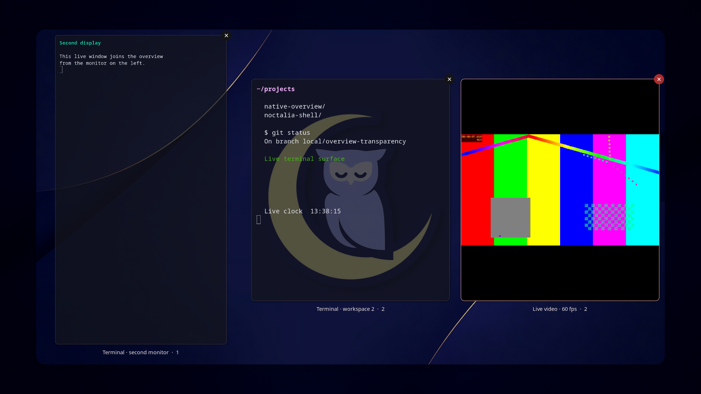
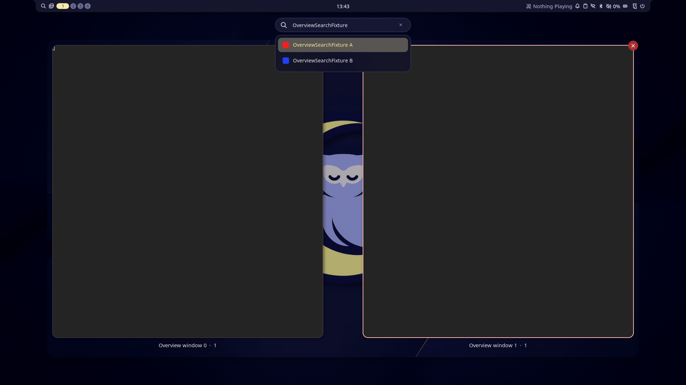

# Window overview preview

Screenshots from isolated two-output test sessions using the proposed Umbriel and Noctalia branches. All applications and content shown are test fixtures.

- [Umbriel draft](https://github.com/noctalia-dev/umbriel/pull/879)
- [Noctalia branch](https://github.com/demencia89/noctalia/tree/feat/umbriel-window-spread)

[Secondary monitor wallpaper](secondary-monitor.png)

This separate branch hosts review images; the feature PRs contain no screenshot assets.
